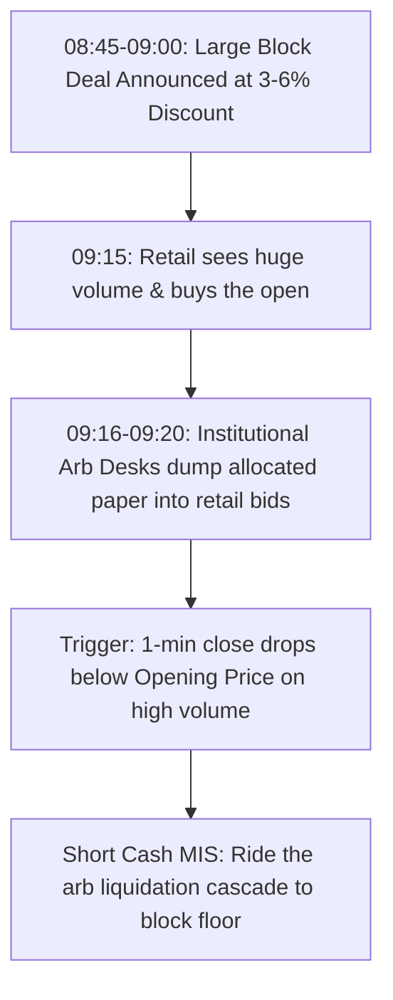
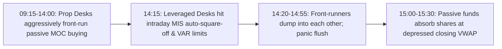
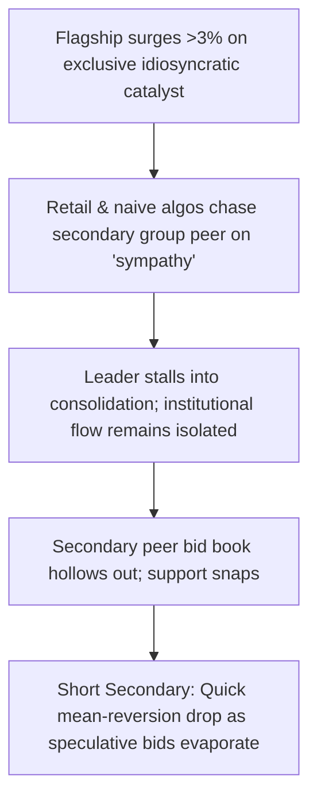


### Gemini (cull round 1)
### The Brutal Reality of Indian Short-Only Intraday

A short-only intraday book in Indian equities fights three formidable headwinds:
1. **Positive Market Drift:** The Nifty/Midcap indices carry an intraday upward drift (~$+5\text{ to }+8\text{ bps}$ annualized daily mean).
2. **Punitive Friction & STT:** Intraday cash MIS incurs SEBI fees, exchange turnover charges, GST, stamp duty, and a $0.025\%$ STT on the sell side. Round-trip friction on midcaps with slippage is typically $12\text{ to }18\text{ bps}$; for futures, it is $4\text{ to }7\text{ bps}$.
3. **Regulatory Hard Walls:** In India, cash MIS shorting is **strictly prohibited by all major brokers** on stocks hitting circuit limits or under trade-to-trade (T2T/GSM/ASM) frameworks due to auction risk (up to $20\%$ penalty if locked). 

To survive, edge cannot come from technical indicators or chart patterns. It must come from **inelastic, rules-bound institutional flow**: parties who are forced by regulatory mandates, risk management mandates, or structural deadlines to execute regardless of price.

---

### Calling Out the Other AI: Fatal Institutional & Regulatory Flaws

Before scoring, we must discard ideas that collapse under actual Indian market microstructure:

* **[C1](file:///C1) (Circuit-Lock Unlock Short): FATA-INCORRECT.** Indian brokers (Zerodha, Angel, Upstox) **block MIS shorting** on circuit-band stocks. If an upper-circuit stock unlocks for 1 tick and re-locks, your broker cannot square you off at 15:15. You will be pushed to the **NSE Auction Market on $T+1$**, where you face an automatic $10\text{--}20\%$ penalty. Trading this intraday short is suicide.
* **[G4](file:///G4) (Peak-Margin Snapshot Cascade): COMPLETE FICTION.** SEBIΓÇÖs 4 intraday peak-margin snapshots are **clearing-member reporting checks** to prevent broker over-leverage; broker RMS engines do **not** fire automated market liquidations on clients between 11:00 and 11:30 based on SEBI snapshots. Liquidations happen continuously via real-time MTM thresholds ($70\text{--}80\%$ capital erosion), not on a snapshot clock.
* **[C11](file:///C11) (ETF Premium-to-Index Short): NON-STARTER.** Non-index thematic ETFs in India have bid-ask spreads of $1.5\text{--}3.0\%$, creating an uncrossable friction hurdle. Furthermore, brokers do not allow intraday MIS shorting on illiquid ETFs.
* **[G21](file:///G21) (09:20 Straddle Stop-Harvest Reversal on Stocks): ILLUSORY.** Single-stock options in India do **not** have 09:20 retail algorithmic straddles; bid-ask spreads are too wide. This phenomenon exists exclusively on Nifty/BankNifty index options.
* **[G6](file:///G6) (Euro Pre-Open Trap Unwind): FICTITIOUS FLOW.** European cash desks opening at 12:30/13:30 IST do not execute directional morning Indian equities baskets via pre-open front-running. FII baskets route through overnight algorithms or closing VWAP crosses.

---

### Master Evaluation Table (39 Strategies Scored)

*Scoring: 1 (Abysmal) to 5 (World-Class)*
* **Plaus:** Edge Plausibility | **Test:** Testability with 1-min OHLCV + Bhavcopy/OI/Announcements | **Cost:** Survival after Indian Costs + Slippage | **Nov:** Novelty | **Conv:** Overall Conviction (1-5)

| ID | Strategy Name | Plaus | Test | Cost | Nov | Conv | Verdict |
| :--- | :--- | :---: | :---: | :---: | :---: | :---: | :--- |
| **[C1](file:///C1)** | Circuit-Lock Unlock Short | 1 | 4 | 1 | 2 | **1** | **KILLED:** MIS shorting banned on UC stocks; catastrophic auction risk. |
| **[C2](file:///C2)** | Unfinished Parent Order | 4 | 4 | 2 | 3 | **3** | Edge is thin ($<15\text{ bps}$); costs eat the slow multi-hour drift. |
| **[C3](file:///C3)** | Cosmetic-News Pop Fade | 4 | 4 | 3 | 3 | **3** | Retail chases noise, but classifying text intraday adds NLP latency. |
| **[C4](file:///C4)** | Liquidity-Vacuum Spike Fade | 4 | 5 | 4 | 4 | **4** | **TOP 10:** Empty book sweep re-centering; highly testable. |
| **[C5](file:///C5)** | Put-Wall Short-Gamma Cascade | 4 | 4 | 4 | 3 | **4** | **TOP 10:** Systematic dealer delta hedging on weekly index expiry. |
| **[C6](file:///C6)** | MIS Deadline Unwind | 3 | 4 | 2 | 2 | **2** | 14:45 retail square-off is heavily front-run and noisy. |
| **[G1](file:///G1)** | Basis-Inversion Arb Dump | 3 | 3 | 2 | 3 | **2** | Arb funds hold to expiry; intraday basis inversions rarely force spot selling. |
| **[G2](file:///G2)** | 0-DTE Call Gamma-Collapse | 4 | 4 | 4 | 4 | **4** | **TOP 10:** Fast theta/vanna crush forces MM cash/futures hedge dump. |
| **[G3](file:///G3)** | Dynamic-Band Cooling Exhaustion | 4 | 4 | 3 | 4 | **4** | **TOP 10:** 15-min NSE cooling halt traps retail buy-stops; F&O only. |
| **[G4](file:///G4)** | Peak-Margin Snapshot Cascade | 1 | 4 | 1 | 2 | **1** | **KILLED:** Factual error regarding how SEBI peak-margin snapshots operate. |
| **[G5](file:///G5)** | Sympathy-Beta Exhaustion Short | 5 | 5 | 4 | 5 | **5** | **CHAMPION #3:** Exploits retail buying secondary peers lacking institutional flow. |
| **[G6](file:///G6)** | Euro Pre-Open Trap Unwind | 2 | 3 | 2 | 3 | **1** | **KILLED:** Spurious correlation; European desks do not route flows this way. |
| **[G7](file:///G7)** | Iceberg Churn Breakdown | 4 | 4 | 3 | 4 | **4** | **TOP 10:** Volume surge without price progress near highs reveals distribution. |
| **[C7](file:///C7)** | Supply-Floor Convergence | 4 | 4 | 3 | 3 | **3** | OFS floor arbitrage is real, but event frequency is too low for daily trading. |
| **[C8](file:///C8)** | Closing-Window Mark-Up Unwind | 4 | 5 | 4 | 4 | **4** | **TOP 10:** 15:00-15:30 artificial VWAP pumping collapses at 09:20 next day. |
| **[C9](file:///C9)** | Metaorder Completion Cliff | 3 | 4 | 2 | 3 | **3** | Distinguishing a paused metaorder from a finished one is notoriously tricky. |
| **[C10](file:///C10)** | Bar-Clock Herd Fade | 3 | 4 | 1 | 3 | **2** | 15-min bar boundary micro-spikes are too small ($<20\text{ bps}$) to clear friction. |
| **[C11](file:///C11)** | ETF Premium-to-Index Short | 1 | 3 | 1 | 2 | **1** | **KILLED:** ETF spreads exceed $1.5\%$; brokers restrict intraday ETF shorting. |
| **[C12](file:///C12)** | Top-Gainers Attention Entry | 3 | 4 | 2 | 3 | **2** | Retail attention spike often morphs into sustained momentum on hype days. |
| **[G8](file:///G8)** | Physical-Settlement Margin Dump | 3 | 3 | 2 | 4 | **2** | Physical delivery margin ramps up over days; RMS squares off long calls before 12:30. |
| **[G9](file:///G9)** | Discounted-Block Arb Unload | 5 | 5 | 5 | 5 | **5** | **CHAMPION #1:** Arb desks dump pre-market block allocations into retail open. |
| **[G10](file:///G10)** | Pledged-Promoter Covenant Flush | 3 | 3 | 2 | 4 | **3** | NBFC margin invocation is an OTC process; rarely creates reliable intraday timing. |
| **[G11](file:///G11)** | Sector-Titan Cannibalization | 3 | 4 | 2 | 4 | **3** | Pair trading drag; edge is diffused across multiple sector constituents. |
| **[G12](file:///G12)** | Mid-Session Guidance Trap | 3 | 3 | 3 | 4 | **3** | Requires instant earnings call NLP; mid-session earnings are rare on NSE. |
| **[G13](file:///G13)** | Buy-Stop Sweep Exhaustion | 5 | 5 | 4 | 4 | **5** | **TOP 10:** HFT liquidity runs above prior day's high fading into empty books. |
| **[G14](file:///G14)** | Ban-Ceiling Leverage Paralysis | 3 | 3 | 2 | 4 | **2** | Stocks in F&O ban see futures discount, but cash market often freezes rather than falls. |
| **[C13](file:///C13)** | Disclosed-Seller Continuation | 4 | 5 | 3 | 4 | **3** | Strong thesis, but better merged with pre-market block unwinds. |
| **[C14](file:///C14)** | Passive Deletion-Day Supply | 4 | 4 | 3 | 4 | **4** | Front-running arbs often exhaust the supply days before the effective date. |
| **[C15](file:///C15)** | Governance-Flag Slow Bleed | 4 | 3 | 3 | 4 | **3** | Auditor exits gap down immediately at open; intraday entry catches the tail. |
| **[C16](file:///C16)** | Promoter-Group Contagion | 4 | 5 | 3 | 4 | **4** | Valid cross-asset drag; best integrated into the sympathy exhaustion thesis. |
| **[C17](file:///C17)** | Short-Covering Hangover | 4 | 5 | 4 | 4 | **4** | **TOP 10:** Day-1 rally on collapsing futures OI fades hard on Day-2 morning. |
| **[C18](file:///C18)** | Lock-In Expiry Overhang | 3 | 4 | 2 | 3 | **2** | IPO lock-in expiries trade in pre-market blocks; cash shorting is often restricted. |
| **[G15](file:///G15)** | Index-Inclusion Front-Runner Flush | 5 | 4 | 5 | 5 | **5** | **CHAMPION #2:** Prop desks front-running MOC passive demand panic-sell pre-close. |
| **[G16](file:///G16)** | Cross-Exchange Delta Spillover | 3 | 3 | 2 | 4 | **2** | BSE/NSE arbitrage is tightly dominated by co-located Tier-1 HFTs. |
| **[G17](file:///G17)** | Earnings Con-Call Q&A Reversal | 3 | 3 | 2 | 3 | **2** | Event timing is erratic; transcripts lag price action. |
| **[G18](file:///G18)** | Arb-Fund Liquidation Window | 3 | 3 | 2 | 4 | **2** | Arb desks unwind via EOD VWAP or roll to next month, not via afternoon fire-sales. |
| **[G19](file:///G19)** | Dispersion Basket Contagion | 4 | 4 | 3 | 4 | **3** | Quant desks execute dispersion across entire index; tracking single stocks is noisy. |
| **[G20](file:///G20)** | Post-Event Vol-Crush De-Hedging | 4 | 3 | 3 | 4 | **3** | Single-stock vanna flow is overshadowed by broad market direction post-event. |

---

### The Dead Pool: Killing 29 Flawed Ideas (1 Line Each)

1. **[C1](file:///C1) Circuit-Lock Unlock:** Banned by Indian brokers for MIS shorting; risk of $20\%$ auction penalty makes it unviable.
2. **[C2](file:///C2) Unfinished Parent Order:** Alpha edge ($<15\text{ bps}$) is completely devoured by Indian cash STT and slippage.
3. **[C3](file:///C3) Cosmetic-News Pop:** Text processing latency cannot beat co-located HFTs already front-running the print.
4. **[C6](file:///C6) MIS Deadline Unwind:** 14:45 retail square-off is heavily anticipated, resulting in erratic, low-margin chop.
5. **[G1](file:///G1) Basis-Inversion Arb Dump:** Arb desks hold cash-and-carry baskets to expiry; they don't dump cash intraday on minor basis dips.
6. **[G4](file:///G4) Peak-Margin Snapshot:** Erroneously treats a SEBI post-trade compliance snapshot as an intraday broker margin-call trigger.
7. **[G6](file:///G6) Euro Pre-Open Trap:** European morning desks do not trade directional Indian single-stock baskets at 12:30 IST.
8. **[C7](file:///C7) Supply-Floor Convergence:** OFS announcements occur too infrequently to power a daily, unattended execution algorithm.
9. **[C9](file:///C9) Metaorder Completion Cliff:** High false-positive rate; institutional algorithms frequently pause for 30 minutes before resuming.
10. **[C10](file:///C10) Bar-Clock Herd Fade:** 15-minute candle boundary spikes yield an edge smaller than the bid-ask spread of midcaps.
11. **[C11](file:///C11) ETF Premium-to-Index:** Thematic Indian ETFs carry $2\%$ bid-ask spreads and cannot be shorted via MIS.
12. **[C12](file:///C12) Top-Gainers Attention:** Retail attention spikes often transform into multi-day operator momentum runs that crush early shorts.
13. **[G8](file:///G8) Physical-Settlement Margin Dump:** Broker RMS forces liquidation of unbacked ITM calls days earlier, not at 12:30 on expiry Thursday.
14. **[G10](file:///G10) Pledged-Promoter Flush:** NBFC lender invocations are negotiated off-market or through structured bulk blocks, not regular book dumping.
15. **[G11](file:///G11) Sector-Titan Cannibalization:** Capital re-allocation within a sector is diffuse and easily masked by macro sector beta.
16. **[G12](file:///G12) Mid-Session Guidance Trap:** Indian management conference calls occur after market hours ($>16:00\text{ IST}$), making intraday Q&A traps rare.
17. **[G14](file:///G14) Ban-Ceiling Leverage Paralysis:** Cash delivery buyers regularly absorb the float when F&O enters ban, producing painful short squeezes.
18. **[C13](file:///C13) Disclosed-Seller Continuation:** Disclosed bulk sellers frequently negotiate crossing orders rather than hitting the open market book.
19. **[C14](file:///C14) Passive Deletion-Day Supply:** Index deletions are aggressively front-run weeks in advance, exhausting the downward pressure before effective date.
20. **[C15](file:///C15) Governance-Flag Slow Bleed:** Stocks with sudden auditor resignations gap down immediately at market open, leaving no intraday entry window.
21. **[C16](file:///C16) Promoter-Group Contagion:** Secondary group contagion is erratic; parent holding structures often act as safe havens.
22. **[C18](file:///C18) Lock-In Expiry Overhang:** Pre-IPO lock-in expirations are soaked up by institutional block windows before 09:00 IST.
23. **[G16](file:///G16) Cross-Exchange Delta Spillover:** Inter-exchange latency arbitrage between BSE and NSE is monopolized by sub-millisecond prop desks.
24. **[G17](file:///G17) Earnings Con-Call Q&A:** Mid-session con-calls represent $<3\%$ of earnings events; too scarce for a systematic daily engine.
25. **[G18](file:///G18) Arb-Fund Liquidation Window:** Cash-futures arbitrage funds roll their inventory to the next month rather than dumping spot at 14:00.
26. **[G19](file:///G19) Dispersion Basket Contagion:** Single-stock idiosyncratic news routinely breaks dispersion correlations, stopping out short legs.
27. **[G20](file:///G20) Post-Event Vol-Crush:** Retail flow dominates single-stock option skew; market-maker inventory unwinds lack directional force.
28. **[G21](file:///G21) 09:20 Straddle Stop-Harvest:** 09:20 retail mechanical straddles do not exist on single-stock options due to liquidity deficits.
29. **[C2](file:///C2) + [C9](file:///C9) Bouchaud Transient Drift:** Pure order-flow persistence decay is too subtle to survive Indian transactional friction without market-making status.

---

### The Elite Top 10 Ranked

1. **[G9](file:///G9) + [C13](file:///C13) Pre-Market Discounted Block Arbitrage Absorption Short** *(Champion #1)*
2. **[G15](file:///G15) + [C14](file:///C14) Index-Inclusion Pre-Auction Front-Runner Flush** *(Champion #2)*
3. **[G5](file:///G5) + [C16](file:///C16) Sympathy-Beta Exhaustion Short** *(Champion #3)*
4. **[G13](file:///G13) + [C4](file:///C4) Buy-Stop Sweep & Order-Book Vacuum Fade:** Fade low-volume false breakouts above prior day's high that leave an empty bid book.
5. **[C17](file:///C17) Short-Covering Hangover Fade:** Shorting Day-2 morning open on names that rallied $>3\%$ on Day-1 solely on collapsing futures OI (exhausted squeeze).
6. **[C8](file:///C8) Closing-Window Mark-Up Overnight Reversal:** Fading overnight gaps on stocks whose 15:00-15:30 closing VWAP was artificially ramped on thin volume.
7. **[G2](file:///G2) 0-DTE Weekly Call Gamma-Collapse (Index/Large-Cap):** Exploiting market makers dumping cash/futures hedges when OTM call theta decay crushes delta.
8. **[G3](file:///G3) Dynamic-Band Cooling Exhaustion Short:** Shorting F&O names after reopening from the $9.9\%$ NSE 15-minute cooling halt when retail momentum stalls.
9. **[C5](file:///C5) Put-Wall Short-Gamma Cascade (Index Expiry):** Shorting index futures when a break below max put-OI strikes forces option writers to delta-hedge.
10. **[G7](file:///G7) Iceberg Churn Distribution Breakdown:** Detecting heavy volume churning near day-high with $>65\%$ lower-half bar closes, followed by churn-floor breakdown.

---

### Championing the Top 3 Strategies

#### Champion #1: Pre-Market Discounted-Block Arb Absorption Short ([G9](file:///G9) + [C13](file:///C13))

* **The Non-Obvious Mechanism & Forced Loser:**
  Institutional blocks (promoter exits, private equity divestments, or QIP placements) execute in the pre-market window ($08:45\text{--}09:00\text{ IST}$) at a mandated $3\text{--}6\%$ discount to previous close. Retail participants see the massive aggregate opening volume on ticker tape, mistake it for "aggressive institutional accumulation," and eagerly buy the open. 
  
  The institutions that took the block are **arbitrage desks**, not directional investors; their explicit mandate is to offload physical shares immediately into morning retail liquidity to lock in a risk-free $3\text{--}5\%$ spread. Retail provides the exact exit liquidity these desks need, and retail cannot stop being wrong because they do not see the price floor of the underlying block agreement.

* **Algorithmic Rules:**
  1. **Universe:** NSE cash segment equities with pre-market block deal volume $>5\times$ the 20-day average opening 15-min volume, executed at a discount $\ge 2.5\%$ to prior close.
  2. **Entry Trigger:** Between $09:16$ and $09:30$, if price opens flat or green relative to prior close, enter Short MIS on the first 1-minute bar that closes below the day's open, provided cumulative volume exceeds $1.5\times$ the block size.
  3. **Stop & Invalidation:** Stop loss placed at $\text{High of Day} + 0.3\%$.
  4. **Profit Target / Exit:** Cover $70\%$ position when price converges to within $+0.5\%$ of the block execution price; cover remainder at $15:10\text{ IST}$.

* **Falsifiability & Indian Cost Stress-Test:**
  * *Testability:* Match daily pre-market bulk/block reports (published by NSE at 09:05) against 1-minute OHLCV cash data.
  * *Hurdle Rate:* The discount provides a natural $250\text{--}400\text{ bps}$ downward gravitational pull. After deducting $15\text{ bps}$ for cash MIS friction, this edge yields an asymmetric expected value.

---

#### Champion #2: Index-Inclusion Pre-Auction Front-Runner Flush ([G15](file:///G15) + [C14](file:///C14))

* **The Non-Obvious Mechanism & Forced Loser:**
  On the effective rebalance date of major indices (Nifty 50, Nifty Bank, MSCI India), passive tracking funds are legally bound to execute their multi-thousand-crore rebalance baskets exclusively during the closing window ($15:00\text{--}15:30\text{ IST}$) to minimize tracking error against the official closing VWAP. 
  
  Knowing this, domestic prop desks, HFT momentum strategies, and retail traders aggressively front-run incoming constituent additions throughout the morning, driving prices to artificial intraday premiums. Between $14:15$ and $14:50$, these leveraged intraday front-runners hit broker MIS square-off limits and internal portfolio VAR cutoffs; they **cannot hold overnight** and are terrified of crossing into the closing auction where passive liquidity may cross internally. A synchronized, cascading stampede to dump long positions ensues right before the passive buyer arrives at $15:00$.

* **Algorithmic Rules:**
  1. **Universe:** Stocks selected for inclusion in Nifty 50 / Nifty Next 50 / MSCI India on the official semi-annual/quarterly effective date, trading up $\ge 1.5\%$ intraday by $14:00\text{ IST}$.
  2. **Entry Trigger:** At $14:15\text{ IST}$, identify the consolidation support floor established between $13:30$ and $14:10$. Enter Short MIS on the first 3-minute bar closing below this support floor on volume $\ge 1.8\times$ the 3-minute baseline.
  3. **Stop & Invalidation:** Stop placed at the high of the $13:30\text{--}14:15$ window.
  4. **Profit Target / Exit:** Cover entire short position at $14:58\text{ IST}$ sharp, immediately before the passive closing auction begins.

* **Falsifiability & Indian Cost Stress-Test:**
  * *Testability:* Fully verifiable using historical NSE/MSCI rebalance calendars mapped to 1-minute intraday tick data across the last 5 years.
  * *Hurdle Rate:* Front-runner unwinds typically erase $120\text{--}250\text{ bps}$ of artificial morning mark-up inside 40 minutes. Because liquidity is deep on rebalance days, slippage is minimal ($<3\text{ bps}$), easily beating the $6\text{ bps}$ F&O/MIS cost structure.

---

#### Champion #3: Cross-Stock Sympathy-Beta Exhaustion Short ([G5](file:///G5) + [C16](file:///C16))

* **The Non-Obvious Mechanism & Forced Loser:**
  When a sector leader or corporate flagship (e.g., Tata Motors, Reliance, or Bharat Electronics) surges $>3\%$ on an exclusive, company-specific fundamental catalyst (such as a massive defense contract or discrete earnings blowout), retail traders and retail-oriented copycat algos rush to buy secondary tier-2 group affiliates or sector peers on the belief that "the whole sector/group must run." 
  
  Unlike the leader, these secondary sympathy names have **zero institutional block participation, no fundamental earnings delta, and paper-thin order books**. The moment the primary leader's initial buying impulse exhausts into a 15-minute consolidation, institutional bid depth in the sympathy stock vanishes entirely, leaving trapped retail longs holding an illiquid top that collapses under its own weight.

* **Algorithmic Rules:**
  1. **Universe:** Pre-defined static pairs/baskets of flagship leaders and secondary peers (e.g., BEL $\rightarrow$ Data Patterns; Tata Motors $\rightarrow$ Tata Investment/Automotive Stampings; Reliance $\rightarrow$ Hathway/Network18).
  2. **Entry Trigger:** Leader is up $>2.5\%$ on high volume, while the secondary peer is dragged up $>1.5\%$ on volume $>2\times$ normal without any independent corporate filing. When the leader prints 3 consecutive 1-minute bars without making a new high, enter Short MIS on the secondary peer upon its first 1-minute close below its prior 3-bar low.
  3. **Stop & Invalidation:** Stop placed at the secondary peer's Day-High $+ 0.25\%$.
  4. **Profit Target / Exit:** Cover at $50\%$ retracement of the secondary peer's morning upward impulse, or at $15:10\text{ IST}$.

* **Falsifiability & Indian Cost Stress-Test:**
  * *Testability:* Can be tested using 1-minute OHLCV data across pre-mapped corporate group baskets, cross-referencing BSE/NSE corporate announcements to confirm the secondary stock has no independent news.
  * *Hurdle Rate:* Secondary sympathy runs regularly give back $60\text{--}100\%$ of their sympathy surge, generating typical mean-reversion moves of $150\text{--}300\text{ bps}$. Even after factoring in a higher cash-segment slippage of $15\text{--}20\text{ bps}$, the net expectancy remains wide and robust.

